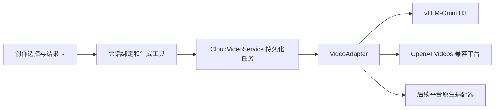

# 云端图片与视频 API 接入

## 接口选择

使用**客户端统一任务模型 + 协议适配器**。优先对接平台实际提供的 OpenAI Images / Videos 端点；有专属能力的平台通过适配器映射。聊天接口兼容 OpenAI 不代表支持图片或视频端点。

当前用户部署的 MiniMax H3 是 **vLLM-Omni HTTP 服务**，并非 ComfyUI 工作流服务。它的创建、查询、下载路径采用 OpenAI Videos 风格，同时需要 H3 扩展字段。不能只替换聊天接口的 Base URL。

| 后端                   | 当前入口                         | 参数与输出                                              |
| ---------------------- | -------------------------------- | ------------------------------------------------------- |
| 云端图片               | 既有图片服务商配置               | OpenAI Images / Gemini 等现有图片链路                   |
| 云端 H3                | 视频 → 云端 → 配置云端 API       | vLLM-Omni，文生、首帧、首尾帧，含音频                   |
| OpenAI Videos 兼容平台 | 同一配置窗口，选择 OpenAI Videos | `model/prompt/seconds/size/input_reference`，最多一张图 |
| 本地 ComfyUI           | 视频或图片 → 本地                | 已有工作流、安装、运行时及任务链路                      |

## 使用客户端

1. 在创作区选择「视频」和「云端」，点击模型菜单里的「配置云端 API」。未配置的 H3 条目也可打开配置。
2. H3 协议选 `vLLM-Omni · MiniMax H3`，地址填写 `http://10.1.1.32:8091/v1`。模型留空使用服务端模型；当前内网服务不要求 Key。LoRA 路径已按部署文档预填，部署路径改变时在此修改。

模型菜单中的「已配置」表示连接已保存在当前客户端资料目录；开发版与安装版使用各自的目录。保存 H3 后，不再重复显示同一部署的「待配置」预设。已配置连接可在菜单里编辑，也可选择「添加云端 API」接入其他服务。接口协议只在配置窗口中选择，不是第二层模型列表。

本地模型菜单仅列出已发现或注册的模型配置，保留各自的验证状态；没有模型时显示「未安装本地模型」。可安装的 H3、FastH3-Omni 等推荐保留在下方模型卡片中，卡片存在不代表权重已下载。库存检查失败与没有安装分别显示，不把查询错误当成未安装。

3. 保存并选择连接后，在对话中描述视频；上传一张图为首帧，两张图按上传顺序作为首尾帧。当前部署没有 Ref2VA，不能接收三图、参考视频或音频输入。
4. Agent 提交后结束本轮，结果卡自动显示排队、生成和播放。云端未报告真实进度时保持 0%，不根据耗时模拟进度。
5. 对接其他平台时选择 `OpenAI Videos`，填写该平台的视频 API 地址、模型和 Key。地址包含 API 前缀，例如 `https://provider.example/v1`；适配器在其后添加 `/videos`。平台返回独立任务结构、下载 URL 或不同鉴权方式时需要新增适配器。

配置窗口保留新增连接入口，可以保存多个平台。原连接的配置编辑只影响后续任务，已提交任务继续使用提交时的配置快照。「已配置」表示连接已保存，真实可用性由平台调用结果决定。

## 维护边界

- `common/chat/document/creation/cloudVideo.ts`：连接、输入、任务、适配器合同；`cloudVideoApi.ts`：客户端对本机媒体服务的调用。
- `process/services/media/cloud/videoAdapters.ts`：能力校验、H3/OpenAI 表单、远端状态规范化和 HTTP。新增原生平台实现 `VideoAdapter.submit/retrieve/download`，在适配器工厂选择，不把平台判断散落到 React 或 MCP 工具中。
- `CloudVideoService.ts`：幂等提交、任务持久化、重启恢复、轮询、下载到本地；`routes.ts`：配置权限、会话访问和 Range 播放。
- `guid/Creation/CloudVideoSetup.tsx`、`useCreationModels.ts`：连接配置和选择；`runtime/Creation/CloudVideoResult.tsx`：结果卡。MCP 只传输入和任务标识，不接收平台 Key。
- 图片接口继续使用 `imagesApi.ts` 等既有适配层。后续图片平台在图片适配层扩展；对图片和视频共享连接/任务合同前，先明确异步图片、参考素材和输出语义，避免将视频参数放进聊天请求。

本机媒体服务把连接与任务保存在数据目录下 `cloud-video/cloud-video.json`，生成文件为同目录的 `<job-id>.mp4`。该文件包含 Key，属于私有运行数据；连接列表只返回 `hasApiKey`。Key 不放进对话、localStorage、MCP 环境或工具结果。配置和绑定操作要求现有 Electron UI capability token；当前配置入口面向桌面客户端。

## H3 固定配方

默认文生 1344×768、24fps、4.4 秒；其他比例按短边 768 和 32 像素对齐映射。参考图未显式指定尺寸时交给服务端处理。时长限制为 4–15 秒；较长视频仍可能受服务端显存限制。

每次请求由适配器写入 `num_inference_steps=9`、`flow_shift=6`、`audio_flow_shift=3` 和指定的 8 步 LoRA（scale=1）。用户/Agent 输入不能覆盖这份部署配方。文生为 `t2va`；单图为 `fl2va` + `input_reference`；双图为 `fl2va` + 重复 `input_references` + `frame_indices=[0,-1]`。OpenAI Videos 适配器不发送这些扩展。

## 任务与故障语义

`requestId` 绑定会话和连接；每次用户发起的生成使用一个新的 `submissionId`。同一对标识重复调用返回已有任务，恢复丢失响应时必须复用原标识。后续迭代可使用新的 `submissionId`。

提交只 POST 一次；网络异常或服务端 5xx 导致无法确认接收时记录 `submissionUncertain`，不会自动补交。取得远端 ID 后立即持久化；客户端重启只恢复 GET 查询，不重复生成。queued 不设总等待超时，临时查询/下载故障继续查询原任务。明确的凭据/参数拒绝或远端404显示失败。

生成结束后下载到临时文件，限制为 1GiB 并检查 MP4 容器签名，原子保存后才显示成功。客户端通过会话限定的本机 URL 播放，支持 Range。当前未开放远端取消：不能将删除资源视为已确认停止 GPU 推理。客户端更新只等待本地正在进行的提交/下载，远端任务按持久化 ID 在更新后恢复。

## 验证记录（2026-11-02）

通过当前部署 `/health`、`/v1/models` 和 `/openapi.json` 核实协议。文生、首帧、首尾帧三种真实任务均已通过新适配器提交、轮询及下载；ffprobe 确认均为 1344×768、24fps、H.264、32kHz 双声道 AAC、时长 4.458333 秒。详细结果保留于本地 `.runtime/cloud-video-verification/ffprobe-results.json`。

定向测试覆盖协议字段、首尾帧顺序、参数限制、UI 配置、会话绑定、MCP 调用、密钥隔离、单次提交、配置快照、重启恢复、临时网络故障和 Range 播放。第三方 OpenAI Videos 使用合同测试验证，尚未使用外部平台真实凭据生成。

最终验证：14 个测试文件共 193 项通过；TypeScript、i18n、格式和 lint 检查通过（lint 为0错误）；生产构建通过。编译后的独立媒体服务也已启动验证健康检查、配置保存、密钥隔离和会话绑定。此轮完成源码及生产构建，未制作或替换 Windows 安装包。

参考：[vLLM-Omni Videos](https://docs.vllm.ai/projects/vllm-omni/en/latest/serving/videos_api/)、[OpenAI Videos](https://developers.openai.com/api/reference/resources/videos/methods/create)。H3 部署专属字段以用户提供的《Minimax-H3-API使用说明.md》为准；本文没有把其中的服务启停命令作为执行指令。
